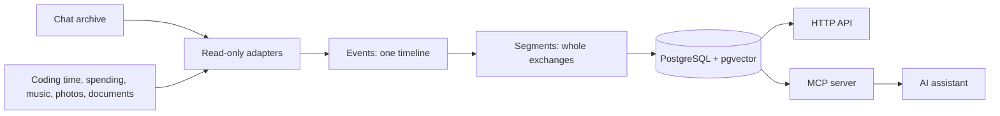

<!-- readme:header:start -->
<picture><source media="(prefers-color-scheme: dark)" srcset="https://raw.githubusercontent.com/Egoushka/Egoushka/main/assets/card-chronicle-dark.svg"></picture>

<p>
  
  <a href="https://github.com/Egoushka/chronicle/actions/workflows/ci.yml"></a>
  
</p>
<!-- readme:header:end -->

# chronicle

> Self-hosted memory for one person's chat archive and activity streams, indexed by conversation instead of by message and served to AI assistants over MCP.

<!-- readme:status:start -->
**Parked**. It works; I am not changing it now and may come back.
<!-- readme:status:end -->



## Why

My Telegram archive holds 681,331 messages over seven and a half years, and 65% of them are under 20 characters:
`ок`, `ага`, `+1`, `😂`. The sync service I ran embedded every message, so about 442,000 vectors were filler that
crowded every nearest-neighbour search and buried the 1.5% of messages that say something. I wanted an assistant
to look things up in what I said and did, and that meant indexing whole exchanges, not single lines.

## What it does

- **Indexes conversations, not messages.** Each chat is cut into *segments* (a run of messages that belong
  together) at a time gap fitted to that chat, with a size cap and replies holding an exchange together.
- **Reads what I already self-host.** 19 adapters over PostgreSQL, MariaDB, SQLite, JSONL files and HTTP APIs map
  every source onto one event shape. A source declares a density, and density decides how hard it is rolled up
  first: editor heartbeats become coding sessions, GPS points become stays, scrobbles become listening sessions.
- **Answers each kind of question with its own tool.** Hybrid search for lookups, an earliest match for "when did
  this first come up", per-period search for how a view changed, read-only SQL for counting, and a timeline.
  Routing is fixed rules, logged and overridable.
- **Matches names across scripts.** Russian, Ukrainian and Latin spellings of one name (Егор, Єгор, Yehor) resolve
  to the same keys ([ADR-002](docs/ADR-002-entity-resolution.md)).
- **Forgets on request.** Every derived row cites the events it came from, so excluding a chat removes everything
  built from it, and secrets are redacted before a row is stored.
- **Measures itself against grep** on questions you write yourself.

Not here: accounts or authentication, a trained query router, a recency penalty on old content, summaries of
summaries. Enrichment (an LLM pass that extracts facts per segment) exists and is off: it lowered the score.

> [!WARNING]
> The database holds every message of every chat it reads, other people's words included, and nothing
> authenticates. Keep ports 8030 and 8031 on loopback and reach them over an SSH tunnel ([SECURITY.md](SECURITY.md)).

## Quick start

Needs Docker with Compose and a source to read; the [quickstart guide](docs/guide/quickstart.md) walks through one
Telegram archive step by step.

```bash
git clone https://github.com/Egoushka/chronicle.git && cd chronicle
cp .env.example .env                                   # DB_PASSWORD, the owner, one block per source
cp compose.sources.example.yaml compose.override.yaml  # how the worker reaches your sources; trim it
docker compose up -d chronicle-db chronicle-api chronicle-mcp

docker compose --profile batch run --rm chronicle-worker python -m chronicle.worker doctor --tier 1
docker compose --profile batch run --rm chronicle-worker python -m chronicle.worker all --tier 1
```

`doctor` checks every source read-only before a single row is ingested: reachability, timestamps that are really
timestamps, duplicate ids, import time posing as event time. Every database adapter here was wrong somewhere the
first time it met a real database. `all` runs ingest, fit-gaps, segment, enrich (off) and embed; every stage is
incremental, so the same command is the nightly job. Point an MCP client at `http://127.0.0.1:8031/sse`.

## How it works

Adapters read each source read-only and write immutable **events**. The worker fits a time gap per chat and cuts
events into **segments**, each storing `raw_text` (what a hit returns) and `embed_text` (what gets indexed). One
PostgreSQL holds everything: BGE-M3 embeddings as `halfvec(1024)` with an exact scan instead of an approximate
index, so date filters stay exact ([ADR-001](docs/ADR-001-postgres-not-qdrant.md)), plus a full-text branch
weighted by how rare each word is. The two ranked lists merge by reciprocal rank fusion. A question that names its
own period ("in January 2026") gets that date window.

The invariant: nothing is indexed one message at a time, and no model decides which of two facts is newer (that is
`max(version)` in code). The api and the MCP server expose the same seven operations, `recall`, `first_mention`,
`evolution`, `tally`, `timeline`, `open_commitments` and `ground` ([reference](docs/guide/reference.md#mcp-tools)).
Every database-backed adapter has run against its real application's database on my deployment.
[How it works](docs/guide/how-it-works.md) follows the pipeline in detail.

## Numbers

All measured on my deployment, one home server with 16 shared CPU cores.

| | Value | Source |
|---|---|---|
| Archive | 681,331 messages, 487 chats, 2018-12-30 onward | [RESEARCH.md](docs/RESEARCH.md#1-executive-summary), queried 2026-07-25 |
| Messages under 20 / 60 characters | 65.0% / 94.0% | same |
| Messages over 200 characters | 1.5% (10,484) | same |
| Messages that reply to another | 7.9% | same |
| First full ingest | 685,401 events, no loss, no duplicates | [CLAUDE.md](CLAUDE.md#status), 2026-08-11 |
| Index reduction | 685,401 events → 51,044 segments (13.4×), 13.4 events and 488 characters each | same |
| Retrieval quality by memory unit, SeCom (ICLR 2025) | segment 71.57, turn 65.58, session 63.16, summaries 53.87–56.25 | [RESEARCH.md](docs/RESEARCH.md) |
| chronicle vs ripgrep, 71 of my questions | **75.4% vs 54.2%** | [CHANGELOG 0.4.0](CHANGELOG.md#040---2026-09-29), 2026-09-29 |
| ripgrep allowed the answer's words | 68.4%, still below | [CHANGELOG](CHANGELOG.md), 2026-09-29 |
| First eval, 37 questions | 63.5% vs 62.8%, level | [CLAUDE.md](CLAUDE.md#status), 2026-09-26 |
| Segment size cap | 15 beat 20 beat 30 (73.2 / 71.6 / 71.1%) | [CHANGELOG 0.4.0](CHANGELOG.md#040---2026-09-29) |
| Enrichment on vs off | 71.8% vs 75.4%, so it stays off | [CLAUDE.md](CLAUDE.md#status), 2026-09-29 |
| Warm `/recall` | ~0.4 s | [CLAUDE.md](CLAUDE.md#hard-won-facts--do-not-relearn-these), fact 24, 2026-09-14 |
| First embed of 51k segments | ~9.8 h on CPU | [CLAUDE.md](CLAUDE.md#status), 2026-08-11 |
| Memory | api 2.5 GB, db 2 GB resident; worker 8 GB while it runs, then exits | [compose.yaml](compose.yaml) `mem_limit` |

The questions are one person's, and the margin depends on the grep it is compared against, so the rule for grep's
keywords (only the question's own words) is written down in [CLAUDE.md](CLAUDE.md#status).

## Lessons

- **The unit matters more than the model.** Every weakness of the per-message index traced back to embedding
  `ок` 442,000 times; no tuning above that layer would have fixed it.
- **Measure what you think is slow.** A 25-second query that I blamed on the CPU was one cold call; the warm cost
  was SQL, and fixing one materialized CTE took `/recall` from 7.4 s to 0.4 s.
- **An extraction pass can hurt retrieval.** LLM-written facts pulled the wrong segments up, and the A/B said so.

The full list, 52 facts each with its regression test, is in [CLAUDE.md](CLAUDE.md#hard-won-facts--do-not-relearn-these).

## Docs

- [Overview](docs/guide/index.md): who it is for, what it leaves out, where it stands
- [Quickstart](docs/guide/quickstart.md): from a clone to a first answer from `/recall`
- [Connect a source](docs/guide/sources.md): every adapter, its tier and the variables it needs
- [Deploy and operate](docs/guide/operate.md): nightly run, upgrades, erasure, redaction, gated enrichment, rollback
- [Measure it against grep](docs/guide/evaluate.md): the evaluation harness and how to keep it honest
- [How it works](docs/guide/how-it-works.md) · [Reference](docs/guide/reference.md) · [Status and evidence](docs/guide/status.md) · [Develop](docs/guide/develop.md)
- [Research](docs/RESEARCH.md) · [Deploy notes](docs/DEPLOY.md) · ADRs [001](docs/ADR-001-postgres-not-qdrant.md), [002](docs/ADR-002-entity-resolution.md), [003](docs/ADR-003-onnx-query-encoder.md)
- [Roadmap](ROADMAP.md) · [Changelog](CHANGELOG.md) · [Security](SECURITY.md)

Apache-2.0, see [LICENSE](LICENSE) and [NOTICE](NOTICE). Not affiliated with or endorsed by Telegram or any service it reads.
